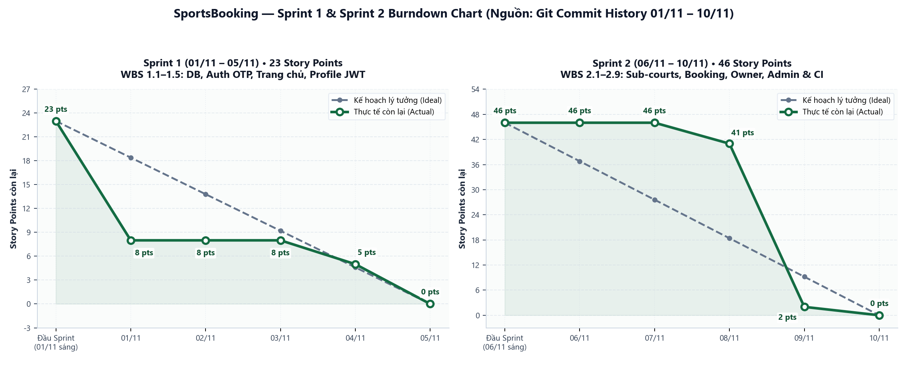

# PROJECT CHARTER — HIẾN CHƯƠNG DỰ ÁN PHẦN MỀM

**Tên dự án:** **SportsBooking** — Hệ thống Quản lý và Đặt sân Thể thao Trực tuyến (Multi-vendor)  
**Học phần:** Quản trị Dự án Phần mềm (QTDAPM) · Trường ĐH CNTT & Truyền thông Việt – Hàn (VKU)  
**Phiên bản tài liệu:** `v1.0` · **Ngày lập:** `11/11/2026`

---

## 1. Thông tin chung về dự án

| Hạng mục | Thông tin chi tiết |
| :--- | :--- |
| **Tên dự án** | **SportsBooking** — Hệ thống Quản lý và Đặt sân Thể thao Trực tuyến (Multi-vendor) |
| **Mã nhóm / Lớp học phần** | `[Điền Mã nhóm — Lớp học phần, ví dụ: Nhóm XX - 23IT.B...]` |
| **Sourcing Pathway (Nguồn gốc đề tài)** | **Đề tài tự đề xuất phát triển sản phẩm mới (Student-Originated Greenfield SaaS Product)** — xây dựng mô hình nền tảng trung gian kết nối Người thuê sân và nhiều Chủ sân thể thao |
| **Giảng viên hướng dẫn / Sponsor** | `[Điền Họ và Tên Giảng viên hướng dẫn / Phụ trách học phần]` |
| **Thời gian thực hiện** | **`01/11/2026 – 15/11/2026`** *(3 Sprint thực hiện trên GitHub; có thể điều chỉnh theo lịch chung của học phần `[Từ ngày ... đến ngày ...]`)* |
| **Kho mã nguồn (GitHub Repository)** | https://github.com/TanPhat901/du_an_phan_mem |
| **Bảng quản lý dự án (GitHub Projects)** | https://github.com/users/TanPhat901/projects/1 |

---

## 2. Tuyên ngôn tầm nhìn & Mục tiêu kinh doanh

### 2.1. Bối cảnh thực tế & Vấn đề cốt lõi
Tại các khu vực đô thị, nhu cầu chơi các môn thể thao như Padel, Pickleball, Bóng đá cỏ nhân tạo, Cầu lông, Tennis tăng mạnh, nhưng việc quản lý và đặt sân tại nhiều cơ sở vẫn thực hiện thủ công qua điện thoại, tin nhắn mạng xã hội hoặc ghi chép giấy tại quầy:
1. **Phía Người chơi (`USER`):** Không xem được tình trạng trống theo thời gian thực của từng sân con cụ thể, mất thời gian hỏi lịch thủ công, thiếu minh bạch giá giờ thường/giờ cao điểm, không có vé điện tử và kênh đánh giá tin cậy sau khi trải nghiệm.
2. **Phía Chủ sân (`OWNER`):** Dễ xảy ra đặt trùng lịch (**double-booking**) giữa khách đặt online và khách vãng lai (Walk-in); khó quản lý nhiều cụm sân/sân con cùng lúc, khó khoá khung giờ bảo trì và chưa có báo cáo doanh thu/công suất tập trung.
3. **Phía Quản trị nền tảng (`ADMIN`):** Thiếu công cụ giám sát tổng quan toàn sàn, kiểm duyệt cơ sở mới/hiển thị sân, quản lý tài khoản phân quyền và xử lý các đánh giá vi phạm.

### 2.2. Tuyên ngôn tầm nhìn (Vision Statement)
> **SportsBooking** hướng tới trở thành nền tảng Web đặt sân thể thao trực tuyến tập trung, minh bạch và đồng bộ thời gian thực, giúp **Người chơi** tìm và đặt đúng sân con trong vài chạm, giúp **Chủ sân** số hoá toàn bộ vận hành – lịch đặt – doanh thu – VietQR, và giúp **Quản trị viên** kiểm soát chất lượng toàn hệ thống trên một cơ sở dữ liệu tập trung **PostgreSQL**.

### 2.3. Mục tiêu kinh doanh (Business Objectives)
- **Số hoá toàn trình đặt sân:** Chuẩn hoá quy trình `Tìm kiếm -> Chọn sân con & giờ trống -> Đặt lịch (PENDING) -> Chủ sân duyệt (CONFIRMED) -> Check-in (COMPLETED) -> Đánh giá`.
- **Loại bỏ trùng lịch:** Đảm bảo 0% xung đột đặt trùng slot/sân con nhờ kiểm tra real-time kết hợp ràng buộc duy nhất ở tầng cơ sở dữ liệu (`uq_booking_details_active_sub_slot`).
- **Hỗ trợ mô hình đa nhà cung cấp (Multi-vendor):** Cho phép nhiều Chủ sân cùng vận hành độc lập nhiều cụm sân, khung giờ cao điểm (`is_peak`) và tài khoản nhận chuyển khoản VietQR riêng.

---

## 3. Mục tiêu SMART

| Mã | Mục tiêu cụ thể (Specific & Measurable) | Chỉ số đo lường & Thời hạn (Achievable, Relevant, Time-bound) |
| :--- | :--- | :--- |
| **SMART-01** | **Hoàn thiện kiến trúc & CSDL PostgreSQL** gồm **12 bảng** chuẩn hoá, ENUM phân loại, trigger `updated_at` và **6 file SQL migration** (`database/migrations/*.sql`) cùng **6 nhóm REST API** Express. | Khởi tạo sạch trên mọi máy qua `npm run db:init` & `applyMigrations.js`; hoàn thành xong trong Sprint 1–2 (**08/11/2026**). |
| **SMART-02** | **Hoàn thiện luồng Khách hàng & Chủ sân:** Tìm kiếm/lọc đa tiêu chí, kiểm tra slot trống cấp sân con, đặt/huỷ lịch, vé điện tử VietQR, yêu thích, đánh giá sau Check-in và toàn bộ Dashboard Chủ sân (Walk-in, khoá giờ, giờ cao điểm, KPI, CSV). | 100% tính năng hoạt động với dữ liệu thật PostgreSQL, vượt qua test luồng người dùng trước **09/11/2026**. |
| **SMART-03** | **Hoàn thiện Cổng Quản trị Admin & UI Editorial:** Xây dựng phân hệ `ADMIN` (`AdminDashboard` 5 tab + `/api/admin/*` bảo vệ bằng `adminMiddleware`) và đồng bộ giao diện Editorial cho toàn bộ **17 React components**. | `vite build` đạt 0 lỗi (`45 modules`), API Admin kiểm thử live đạt `401/403` cho sai quyền và `200` cho `ADMIN` trước **09/11/2026**. |
| **SMART-04** | **Chuẩn hoá quản trị dự án trên GitHub (Mục 7):** Thiết lập Branch Protection trên `main`, CI Check tự động, GitHub Projects Board 5 cột, **16 Issues** có Acceptance Criteria và hợp nhất 100% qua PR có Peer Review. | Đạt **4/4 PR (`#19`, `#2`, `#20`, `#21`)** xanh CI, có Peer Review Approve và gộp vào `main` đúng hạn **10/11/2026**. |
| **SMART-05** | **Kiểm thử tích hợp (UAT) & Bàn giao đồ án:** Kiểm thử toàn trình 3 vai trò `USER` / `OWNER` / `ADMIN` trên nhánh `main`, xuất file backup DB `.sql` và hoàn thiện tài liệu Project Charter. | Đạt 100% kịch bản UAT (`Issue #17`) và hoàn tất hồ sơ bàn giao trước **15/11/2026**. |

---

## 4. Phạm vi dự án (In-Scope & Out-of-Scope)

### 4.1. Trong phạm vi phát triển (In-Scope)
1. **Phân hệ Xác thực & Tài khoản (`AuthPage`, `ProfilePage`, `authRoutes`, `profileRoutes`):**
   - Đăng ký 2 bước chọn vai trò (`USER` / `OWNER`) kèm quy trình OTP, đăng nhập JWT (`bcryptjs`), xem/cập nhật hồ sơ cá nhân và đổi mật khẩu.
2. **Phân hệ Người thuê sân (`Navbar`, `HeroSection`, `SearchFilterBar`, `CourtList`, `CourtDetailPage`, `BookingModal`, `MyBookingsPage`, `TicketBarcode`):**
   - Tìm kiếm và lọc theo từ khóa, bộ môn thể thao, khu vực, ngày chơi, khung giờ trống thực tế, khoảng giá và danh sách yêu thích.
   - Xem chi tiết cụm sân & từng sân con (`sub_courts`), chọn giờ thường/cao điểm, đặt lịch yêu cầu đăng nhập, xem vé điện tử QR/VietQR, huỷ đơn và viết đánh giá sau khi đã Check-in (`COMPLETED`).
3. **Phân hệ Chủ sân (`OwnerDashboard`, `ownerCourtRoutes`, `ownerCourtController`):**
   - Quản lý nhiều cụm sân thuộc sở hữu, CRUD sân con (`sub_courts`), cấu hình khung giờ hoạt động lẻ/hàng loạt & đánh dấu giờ cao điểm (`is_peak`).
   - Xem ma trận lịch đặt theo ngày, duyệt/từ chối/Check-in đơn đặt, đặt lịch tại quầy (Walk-in), khoá slot bảo trì (`court_blocks`), xem KPI doanh thu 7 ngày, xuất báo cáo CSV và cấu hình tài khoản VietQR.
4. **Phân hệ Quản trị viên (`AdminDashboard`, `adminRoutes`, `adminController`, `adminMiddleware`):**
   - Tổng quan KPI toàn sàn theo 7/14/30 ngày, bật/tắt trạng thái hiển thị cụm sân, quản lý tài khoản (tạo mới, khoá/mở khoá, phân quyền `USER`/`OWNER`/`ADMIN`), CRUD bộ môn thể thao, quản lý đơn đặt và kiểm duyệt đánh giá.
5. **Hạ tầng CSDL, Quy chuẩn GitHub & Tài liệu:**
   - 12 bảng PostgreSQL + trigger + 6 migrations, `.github/` (Issue/PR Templates & CI workflow `ci-check.yml`), GitHub Projects Kanban, báo cáo Burndown & Project Charter.

### 4.2. Ngoài phạm vi phát triển (Out-of-Scope)
Để kiểm soát tiến độ trong thời hạn học phần, các hạng mục sau được đưa ra ngoài phạm vi MVP (lưu tại `Backlog` cho giai đoạn mở rộng):
- **Thanh toán tự động qua cổng trung gian thu hộ** (VNPay, MoMo, ZaloPay webhook callback — `Issue #18` ở cột `Backlog`). Hệ thống hiện tại hỗ trợ sinh mã chuyển khoản **VietQR** và để Chủ sân đối soát xác nhận thủ công.
- **Ứng dụng di động Native (iOS / Android)** — hệ thống hiện phục vụ trên trình duyệt Web Responsive (Desktop & Mobile Web).
- **Nhắn tin / Chat thời gian thực (WebSocket)** giữa Người chơi và Chủ sân, hoặc thông báo Push Notification trên thiết bị di động.
- **Thuật toán AI gợi ý ghép kèo thi đấu** hoặc định giá tự động theo dự báo nhu cầu.

---

## 5. Cơ cấu tổ chức & Phân công vai trò

Nhóm được tổ chức tinh gọn và phân công theo **5 vai trò chuẩn công nghiệp** *(Project Manager, Technical Lead, Backend Developer, Frontend Developer, QA/Tester — trong nhóm ít người, thành viên chủ chốt kiêm nhiệm đa vai trò và tách bạch quyền Peer Review chéo)*:

| STT | Thành viên | Mã SV / Tài khoản GitHub | Vai trò chuẩn công nghiệp đảm nhiệm | Trách nhiệm chính trong dự án |
| :---: | :--- | :--- | :--- | :--- |
| 1 | **Hồ Tấn Phát** | `23IT.B162` · `@TanPhat901` (`HoTanPhat_23IT.B162`) | **Project Manager (PM) · Technical Lead · Frontend & Backend Developer** | Điều phối tiến độ Sprint, thiết kế kiến trúc & UI Editorial (`17` components), phát triển Booking real-time, `OwnerDashboard`, `AdminDashboard` + API `/api/admin/*`, thiết lập GitHub Projects, Branch Protection & CI. |
| 2 | **Đoàn Bảo** *(điền tên đệm đầy đủ nếu cần)* | `[Điền MSSV]` · `@BaoDoan205` (`baodn.23itb@vku.udn.vn`) | **Backend Developer · QA / Tester** | Xây dựng `ProfilePage` & tích hợp JWT Auth (`PR #1`), module Quản lý sân con `sub_courts` & migration SQL (`PR #2`), thực hiện Peer Review phê duyệt toàn bộ PR (`#19`, `#20`, `#21`) và kiểm thử tích hợp UAT (`Issue #17`). |
| 3 | `[Họ tên thành viên 3 - nếu có]` | `[MSSV]` · `@[GitHub]` | `[Frontend Developer / QA / Docs - nếu có]` | `[Ghi rõ phần việc phụ trách hoặc xoá dòng này nếu nhóm gồm 2 thành viên]` |

### Ma trận trách nhiệm RACI rút gọn
*(R: Thực hiện · A: Chịu trách nhiệm duyệt/chốt · C: Tham vấn · I: Thông báo)*

| Hạng mục / Phân hệ | Project Manager (`@TanPhat901`) | Tech Lead & Full-stack (`@TanPhat901`) | Backend & QA/Tester (`@BaoDoan205`) |
| :--- | :---: | :---: | :---: |
| Quản lý Scope, GitHub Projects & Milestone | **A / R** | C | I |
| Thiết kế CSDL PostgreSQL & Migrations | A | **R** | **R** *(sub_courts)* |
| Phân hệ Khách hàng & Giao diện Editorial | A | **R** | C *(Peer Review)* |
| Phân hệ Hồ sơ JWT & Sân con (`sub_courts`) | A | C *(Review)* | **R** |
| Phân hệ Chủ sân & Quản trị viên (`ADMIN`) | A | **R** | C *(Peer Review)* |
| Kiểm thử UAT, Bug Tracking & Peer Review PR | C | C | **A / R** |

---

## 6. Cột mốc tiến độ chính (Milestones & Sprints)

Dự án triển khai theo mô hình Agile/Scrum rút gọn qua **3 Sprint** (khớp trực tiếp với 3 Milestones trên GitHub Repository và GitHub Projects `#1`):

| Giai đoạn / Sprint | Thời gian | Khối lượng | Nội dung bàn giao chính (Deliverables) | Trạng thái hiện tại |
| :--- | :---: | :---: | :--- | :---: |
| **Sprint 1** *(Milestone #1)* | `01/11 – 05/11/2026` | **5 Issues · 23 pts** | `WBS 1.1–1.5`: Thiết lập React/Express & PostgreSQL schema; Trang chủ & Chi tiết sân (`CourtDetailPage`); Đăng ký 2 bước OTP; Hồ sơ cá nhân & JWT Auth (`PR #1`); Khung UI Chủ sân ban đầu. | **Hoàn thành (`Done`)** |
| **Sprint 2** *(Milestone #2)* | `06/11 – 10/11/2026` | **9 Issues · 46 pts** | `WBS 2.1–2.9`: Migration & CRUD sân con `sub_courts` (`PR #2`); Đặt sân real-time & Kênh Chủ sân đầy đủ (`PR #20`); Check-in trước đánh giá, VietQR, Editorial UI, Cổng Admin & Docs (`PR #21`); Thiết lập `.github/` Templates & CI Check (`PR #19`). | **Hoàn thành (`Done`)** |
| **Sprint 3** *(Milestone #3)* | `11/11 – 15/11/2026` | **3 pts active + 5 pts backlog** | `WBS 3.1` (`Issue #17`): Kiểm thử chấp nhận (UAT) 3 vai trò `USER`/`OWNER`/`ADMIN` trên nhánh `main`; hoàn thiện tài liệu **Project Charter** & export DB `.sql`. `WBS 3.2` (`#18`): Backlog mở rộng VNPay/MoMo. | **Đang thực hiện (`In Progress`)** |

### Biểu đồ theo dõi tiến độ Sprint 1 & Sprint 2 (Burndown Chart)

*(Đối chiếu số liệu từng ngày xem chi tiết tại [`docs/sprint-burndown.md`](./sprint-burndown.md) và tab **Insights** của [GitHub Projects #1](https://github.com/users/TanPhat901/projects/1)).*

---

## 7. Ngân sách & Tài nguyên dự án

### 7.1. Tài nguyên phần mềm & Hạ tầng công nghệ

| Thành phần | Công nghệ / Nền tảng sử dụng | Mục đích | Chi phí dự toán |
| :--- | :--- | :--- | :---: |
| **Quản lý mã nguồn & PM** | GitHub Repository (`Public`), GitHub Projects v2, Issues, Milestones | Lưu trữ code, Kanban 5 cột, theo dõi tiến độ Sprint | 0 VNĐ *(GitHub Free)* |
| **CI/CD Tự động** | GitHub Actions (`ubuntu-latest`, Node.js 20) | Chạy `Frontend Build (Vite)` & `Backend Syntax Check` cho mỗi PR | 0 VNĐ *(2.000 phút/tháng miễn phí)* |
| **Frontend Stack** | React `18.3.1`, Vite `6.0.7`, Bootstrap `5.3.3`, Bootstrap Icons | Giao diện SPA Editorial responsive cho 3 vai trò | 0 VNĐ *(Open-source)* |
| **Backend Stack** | Node.js, Express `4.21.2`, `jsonwebtoken`, `bcryptjs`, `pg`, `cors` | REST API bảo mật JWT, phân quyền Owner/Admin | 0 VNĐ *(Open-source)* |
| **Cơ sở dữ liệu** | PostgreSQL (`pgAdmin 4` / `pg_dump`) | Lưu trữ tập trung 12 bảng dữ liệu & ràng buộc nghiệp vụ | 0 VNĐ *(Local / Free Cloud Tier)* |
| **Công cụ hỗ trợ** | VS Code / Antigravity IDE, GitHub CLI (`gh`), Python `matplotlib` & `python-docx` | Lập trình, tự động hoá quy trình GitHub, vẽ biểu đồ & xuất báo cáo | 0 VNĐ |

### 7.2. Nguồn nhân lực & Dự phòng triển khai
- **Nguồn nhân lực:** Toàn bộ thành viên nhóm sinh viên tham gia học phần QTDAPM (~72 Story Points tích cực từ 01/11 đến 15/11/2026), không phát sinh chi phí thuê nhân sự ngoài.
- **Dự phòng triển khai mở rộng (nếu đưa lên môi trường Internet thực tế ngoài phạm vi học phần):** Có thể dùng các nền tảng Cloud miễn phí (Vercel/Netlify cho Frontend, Render/Railway + Neon/Supabase PostgreSQL cho Backend/DB) hoặc dự trù chi phí VPS + tên miền khoảng `300.000 – 500.000 VNĐ/tháng`.

---

## 8. Quản trị rủi ro ban đầu

| Mã | Rủi ro nhận diện | Mức độ / Xác suất | Tác động | Biện pháp phòng ngừa & Ứng phó |
| :---: | :--- | :---: | :--- | :--- |
| **R1** | **Đặt trùng lịch cùng một sân con & khung giờ (Double-booking)** | Trung bình / Cao | Sai lệch dữ liệu đặt sân, gây xung đột giữa khách online và khách Walk-in. | Áp dụng Partial Unique Index `uq_booking_details_active_sub_slot` ở PostgreSQL + kiểm tra khung giờ trống real-time trước khi ghi nhận đơn. |
| **R2** | **Lỗ hổng phân quyền hoặc lộ thông tin cấu hình (`.env`, JWT)** | Thấp / Cao | Người dùng thường truy cập trái phép API `OWNER` hoặc `ADMIN`. | Tách `server/.env` vào `.gitignore`; kiểm tra JWT qua `authMiddleware`, kiểm tra role `ADMIN` + trạng thái `ACTIVE` trong DB qua `adminMiddleware`; kiểm tra quyền sở hữu sân cho `OWNER`. |
| **R3** | **Xung đột code hoặc ghi đè nhánh `main` khi làm việc nhóm** | Cao / Trung bình | Hỏng code chạy trên `main`, mất công sức thành viên khác. | Bật **Branch Protection** trên `main` (chặn push trực tiếp), tách nhánh theo Issue/tính năng, bắt buộc merge qua PR + giữ nguyên nhánh lịch sử (`Create a merge commit`). |
| **R4** | **Lệch cấu trúc Database giữa các máy thành viên** | Trung bình / Trung bình | Lỗi thiếu bảng `sub_courts` hoặc thiếu cột `is_peak`, `image_url` khi chạy local. | Chuẩn hoá toàn bộ thay đổi DB vào `schema.sql`, `initDb.js` và `applyMigrations.js` (idempotent `IF NOT EXISTS`). |
| **R5** | **Phình phạm vi (Scope Creep) gây trễ hạn nộp đồ án** | Cao / Trung bình | Không kịp kiểm thử và hoàn thiện các luồng cốt lõi đúng hạn 15/11. | Đóng băng phạm vi MVP; đẩy tính năng mở rộng (cổng thanh toán VNPay/MoMo tự động) sang `Backlog` (`#18`) và bám sát mục tiêu Sprint trên GitHub Projects. |

---

## 9. Tiêu chuẩn chất lượng & Definition of Done (DoD)

Tuân thủ nghiêm ngặt quy định tại **Mục 7 — Chuẩn hoá Quản lý Dự án trên GitHub**:

1. **GitHub Repository & Conventional Commits:**
   - Quản lý mã nguồn tập trung trên GitHub, bật **Branch Protection** cho nhánh `main` (`enforce_admins: true`, cấm force-push, bắt buộc qua PR).
   - Mọi commit mới tuân thủ chuẩn **Conventional Commits**: `feat:` (tính năng), `fix:` (sửa lỗi), `docs:` (tài liệu), `refactor:` (tái cấu trúc), `chore:` (cấu hình/CI/DB).
2. **GitHub Issues & Milestones:**
   - Mỗi nhiệm vụ WBS / User Story tương ứng với **01 Issue** sử dụng `.github/ISSUE_TEMPLATE/user-story.yml`, có đầy đủ **Acceptance Criteria**, **Assignee**, **Story Points** và **Milestone**.
3. **GitHub Projects (Board & Table):**
   - Quản lý luồng công việc Agile/Kanban theo đúng 5 cột trạng thái: `Backlog` → `Ready` → `In Progress` → `In Review` → `Done`, theo dõi biểu đồ tiến độ tại tab Insights và `docs/sprint-burndown.md`.
4. **Definition of Done (DoD) cho mỗi Pull Request:**
   - Đáp ứng đủ **Acceptance Criteria** của Issue liên kết (`Closes #<issue>`).
   - Có **Ghi chú tự kiểm thử (Self-test Notes)** theo `.github/PULL_REQUEST_TEMPLATE.md` xác nhận build Frontend & API Backend hoạt động ổn định.
   - Đạt trạng thái **Pass (xanh)** đối với 2 job CI trên GitHub Actions (`.github/workflows/ci-check.yml`): **`Frontend Build (Vite)`** và **`Backend Syntax & Dependency Check`**.
   - Được ít nhất **01 thành viên khác trong nhóm duyệt (`Peer Review Approval`)** trên GitHub trước khi hợp nhất vào `main`.

---

## 10. Quy chế thông tin & Giao tiếp nhóm

- **Nguyên tắc tập trung (Single Source of Truth):** Mọi phân công nhiệm vụ, tiêu chí nghiệm thu, lịch sử trao đổi kỹ thuật và duyệt code đều lưu vết công khai trên **GitHub Issues**, **GitHub Projects Board** và **Pull Request Comments** (không dùng rời rạc Trello hay Notion).
- **Kênh trao đổi nhanh:** Sử dụng nhóm chat trực tuyến (Zalo / Messenger / Discord) để cập nhật nhanh lỗi phát sinh, nhắc lịch review PR và điều phối test tích hợp.
- **Lịch họp & Đồng bộ:**
  - *Sprint Planning (30 phút đầu mỗi Sprint):* Thống nhất mục tiêu Sprint, chia WBS thành Issues, ước lượng Story Points và gán Assignee.
  - *Check-in tiến độ hàng ngày (Daily Async vào buổi tối):* Mỗi thành viên báo ngắn việc đã xong, việc đang làm (`In Progress`) và vấn đề cần hỗ trợ.
  - *Sprint Review & Retrospective (30–45 phút cuối Sprint):* Chạy demo trên nhánh tích hợp, rà soát Burn-up/Burndown Chart và rút kinh nghiệm quy trình cho chặng tiếp theo.
- **Quy tắc thời gian phản hồi:** Thành viên được gắn làm Peer Reviewer cam kết kiểm tra và phản hồi PR trong vòng **tối đa 24 giờ**.

---

## 11. Các ràng buộc & Giả định

### 11.1. Ràng buộc (Constraints)
- **Thời gian:** Toàn bộ chức năng, kiểm thử và tài liệu phải hoàn thành đúng tiến độ học phần QTDAPM (`15/11/2026`).
- **Chi phí & Hạ tầng:** Sử dụng công cụ miễn phí/mã nguồn mở (GitHub Free Public, PostgreSQL local/free tier), không phát sinh chi phí thương mại.
- **Quy trình bắt buộc:** Không push trực tiếp vào nhánh `main`; mọi tích hợp phải qua Pull Request và Peer Review theo quy định học phần.

### 11.2. Giả định (Assumptions)
- Môi trường chạy demo/kiểm thử của thành viên và giảng viên đã cài đặt **Node.js (v18+ / v20+)** và **PostgreSQL** đang hoạt động bình thường với file cấu hình `server/.env`.
- Luồng thanh toán qua mã **VietQR** đóng vai trò hiển thị thông tin chuyển khoản chính xác theo đơn đặt và tài khoản Chủ sân; việc xác nhận đã nhận tiền do Chủ sân (`OWNER`) đối soát và bấm duyệt trên Dashboard.
- Các thành viên duy trì tài khoản GitHub ổn định và thực hiện đầy đủ các bước kiểm thử UAT trước khi bảo vệ.

---

## 12. Cam kết của nhóm

Toàn thể thành viên nhóm phát triển dự án **SportsBooking** cam kết:
1. Tuân thủ trung thực học thuật, chủ động tự phát triển mã nguồn và ghi nhận đúng công sức đóng góp qua lịch sử commit/PR trên GitHub.
2. Thực hiện nghiêm túc các quy định tại **Project Charter** này: làm việc qua GitHub Issues & Projects Board, tuân thủ Branch Protection, Conventional Commits, tự kiểm thử và duyệt chéo (Peer Review) có trách nhiệm.
3. Chủ động phối hợp xử lý các rủi ro, lỗi kỹ thuật kịp thời và hoàn thành bàn giao sản phẩm đúng thời hạn đã thống nhất.

---

## 13. Phê duyệt & Chữ ký xác nhận

| Đại diện Nhóm phát triển (Project Manager) | Giảng viên hướng dẫn / Phụ trách học phần |
| :---: | :---: |
| *(Ký và ghi rõ họ tên)* | *(Ký và ghi rõ họ tên)* |
|     |     |
| **Hồ Tấn Phát** | **`[Họ và Tên Giảng viên]`** |
| Ngày xác nhận: `11 / 11 / 2026` | Ngày phê duyệt: `.... / .... / 2026` |

**Xác nhận đồng thuận của các thành viên trong nhóm:**
- **Hồ Tấn Phát** (`23IT.B162` — `@TanPhat901`): ___________________________
- **Đoàn Bảo** (`@BaoDoan205` — `[Điền MSSV]`): ___________________________
- **`[Thành viên khác - nếu có]`**: ___________________________

