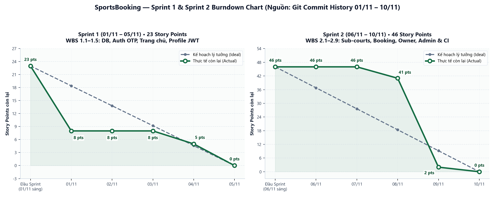

# Biểu đồ Burndown & Theo dõi Tiến độ Sprint (Sprint 1 & Sprint 2)

Tài liệu tổng hợp tiến độ theo ngày của **Sprint 1 (`01/11 – 05/11`)** và **Sprint 2 (`06/11 – 10/11`)** dựa trên lịch sử commit thực tế của kho lưu trữ GitHub và danh sách Issues trên [GitHub Projects #1](https://github.com/users/TanPhat901/projects/1).

---

## 1. Sprint 1 (`01/11 – 05/11`) — Tổng: 23 Story Points

| Ngày | Sự kiện / Commit thực tế | WBS hoàn thành | Story Points giảm | Còn lại (Actual) | Kế hoạch lý tưởng (Ideal) |
| :--- | :--- | :--- | :---: | :---: | :---: |
| Đầu Sprint | Bắt đầu Sprint 1 | — | 0 | **23** | 23.0 |
| `01/11` | `4535f73`, `0537012`, `1ee1b79`, `8fff927`, `c66f53b`, `a911608` | `#3` (1.1), `#4` (1.2), `#5` (1.3) | -15 | **8** | 18.4 |
| `02/11` | Chưa phát sinh commit mới | — | 0 | **8** | 13.8 |
| `03/11` | Chuẩn bị phần UI Chủ sân & Hồ sơ | — | 0 | **8** | 9.2 |
| `04/11` | `35fd1cf`, `3912865` | `#7` (1.5), UI Hồ sơ | -3 | **5** | 4.6 |
| `05/11` | `0ee6263` (hoàn thiện JWT & Profile API, hợp nhất PR `#1` `02c0b0e`) | `#6` (1.4) | -5 | **0** | 0.0 |

---

## 2. Sprint 2 (`06/11 – 10/11`) — Tổng: 46 Story Points

| Ngày | Sự kiện / Commit thực tế | WBS hoàn thành mã nguồn | Story Points giảm | Còn lại (Actual) | Kế hoạch lý tưởng (Ideal) |
| :--- | :--- | :--- | :---: | :---: | :---: |
| Đầu Sprint | Bắt đầu Sprint 2 | — | 0 | **46** | 46.0 |
| `06/11` | Thiết kế mô hình sân con & đặt sân real-time | — | 0 | **46** | 36.8 |
| `07/11` | `02c0b0e` (hợp nhất PR `#1` vào `main`) | — | 0 | **46** | 27.6 |
| `08/11` | `b38a2b0`, `796a424` (`feature/bao`, PR `#2`) | `#8` (2.1) | -5 | **41** | 18.4 |
| `09/11` | `784df4a`–`0d6ad48` (`feature/trang-chu-phat` & `feature/phat`, PR `#20`, `#21`) | `#9` (2.2), `#10` (2.3), `#11` (2.4), `#12` (2.5), `#13` (2.6), `#14` (2.7), `#15` (2.8) | -39 | **2** | 9.2 |
| `10/11` | `046b004`, `44900de` (GitHub CI/Templates/README, PR `#19`, `#21`) | `#16` (2.9) | -2 | **0** | 0.0 |

> **Ghi chú:** Các đầu việc Sprint 2 (`#8`–`#16`) đang ở trạng thái **`In Review`** trên GitHub Projects chờ **Peer Review Approval** qua các Pull Request `#19`, `#2`, `#20`, `#21` trước khi hợp nhất vào `main` và tự động đóng (`Done`).
